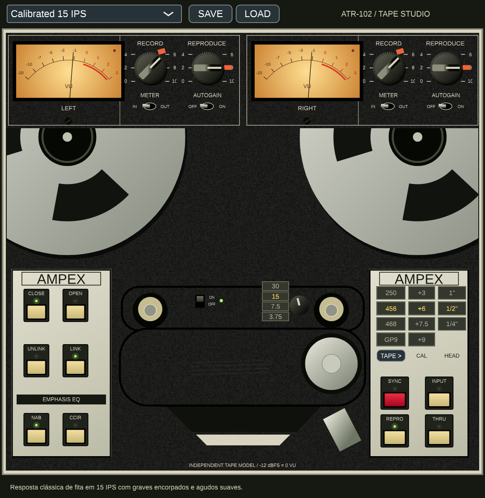
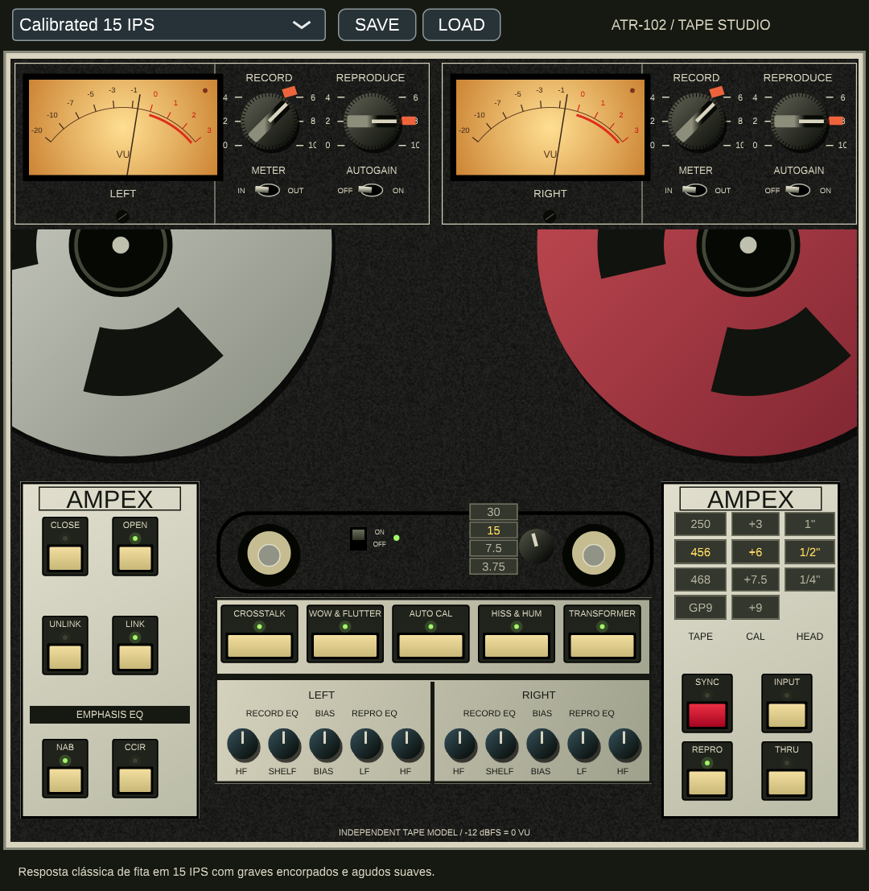

# ATR-102 Tape Studio

Independent stereo tape effect inspired by the supplied ATR-102 front-panel references. Native **VST3 for Windows x64**, with a standalone application and an earlier browser prototype (`index.html`). Not affiliated with or endorsed by Ampex or Universal Audio. The interface is procedurally drawn; it is not an exact reproduction of proprietary artwork. DSP is an original approximation, not a measured hardware model.

[Download Windows x64 VST3](releases/ATR102-Windows-x64-v0.1.3.zip) · [Validation](VALIDATION.md)




## Windows installation

Extract the Windows x64 package. Copy the entire **`ATR-102 Tape Studio.vst3` directory** to `C:\Program Files\Common Files\VST3\`, then rescan VST3 plugins in your 64-bit DAW. Do not extract the inner `.vst3` binary from its `Contents/x86_64-win` directory. No separate browser or WebView is needed. This build is unsigned.

## Controls

- CLOSE is the default: the mechanical head cover, capstan and rollers remain visible. OPEN reveals five circuit switches and ten L/R calibration trims. Both panels use the same processor and parameter state.
- Record and Reproduce are independently automatable (-12 to +12 dB). Their 0 dB positions are drawn at the reference marks 6 and 8. Drag vertically; double-click resets to 0 dB.
- LINK gangs channel gains, autogain and calibration. UNLINK allows independent adjustment. Linking copies left settings to right.
- AUTOGAIN inversely adjusts Reproduce when Record changes. Meter IN / OUT selects a separate input or output RMS meter; -12 dBFS RMS is the nominal 0 VU reference.
- Speeds: 30, 15, 7.5, 3.75 IPS. NAB/CCIR is disabled at 30 IPS (AES mode). Available tape formulas change with speed. At 15 IPS all seven modeled formulas are available, retaining the combinations supplied in the bank. Use TAPE > to switch the four-row matrix between two pages; loading a preset reveals the page containing its active formula.
- AUTO CAL resets all calibration trims. Its indicator turns red after a manual calibration edit.
- CROSSTALK, WOW & FLUTTER, HISS & HUM and TRANSFORMER enable their modeled effects. The mains hum follows NAB 60 Hz / CCIR 50 Hz; 30 IPS uses 60 Hz.
- INPUT and THRU route unity audio with reported oversampling latency compensation. Power off also bypasses processing. SYNC currently shares the REPRO path; separate sync-head physics are not modeled.
- Open/closed panel state, channel settings and current factory program are saved in DAW state. SAVE/LOAD uses `.atrpreset` files.

## Preset library: 80 programs

The selector groups 72 user-supplied entries into Master, Vintage, Lo-Fi, Clean, Pushed, Bright, Vocal, Bass, Classic, Drums and Guitars. The eight original programs remain first under Factory, preserving their program indices and saved sessions. Exact source names are retained, including repeated names in different categories.

### Original factory programs

| Preset | Descrição |
| --- | --- |
| Calibrated 15 IPS | Resposta clássica de fita em 15 IPS com graves encorpados e agudos suaves. |
| Clean 30 IPS | Resposta de frequência ultralimpia e plana, ideal para masterização moderna com mínimo ruído. |
| Warm Master | Saturação suave focada no bus principal para dar calor e peso aos médios/graves. |
| Low Speed Color | Simulação de velocidade reduzida (7.5 IPS), proporcionando textura vintage e roll-off nos agudos. |
| Wide Open GP9 | Modelagem de fita alta fidelidade GP9 com alto headroom e dinâmica aberta. |
| Vintage 250 | Carácter harmónico da fita Ampex 250 dos anos 70/80 com coloração rica. |
| Gentle Glue | Compressão natural leve e coesão ('cola') para conectar os elementos da mistura. |
| Through Reference | Modo transparente de calibração direta / bypass de fita para referência de sinal. |

The eight original names and descriptions are stored in `presets/presets.json`; the complete supplied bank is preserved in `presets/imported-bank.json`. Run `python scripts/generate-preset-metadata.py` after editing either JSON source. It produces `presets/catalog.json` and the native header, including category-qualified identities, original settings and mapped parameter values. The selected description appears below the hardware panel and in the preset selector tooltip. Low Speed Color uses 7.5 IPS.

Presets are available through the native toolbar and host program API. Selecting a factory program preserves OPEN/CLOSE. The eight original `.atrpreset` files remain at the root of `presets`; all 72 supplied entries are exported to `presets/bank/<Category>/<Exact name>.atrpreset`. Program state saves a stable category-qualified ID as well as the legacy numeric program index.

## Imported-bank mapping

- Tape formula, CAL, head width, speed and LINK are mapped directly from each supplied entry.
- A single explicit `emphasis_eq` is retained exactly. For an empty array or a choice between NAB and CCIR at 15 IPS, the engineering starting point is CCIR for Master, Clean, Bright and Vocal; NAB for Vintage, Lo-Fi, Pushed, Bass, Classic, Drums and Guitars. At 7.5/3.75 IPS ambiguous EQ uses NAB. At 30 IPS the EQ selector is inactive (AES mode). If multiple source options are supplied, the chosen EQ must be one of them. The source arrays remain unchanged.
- These are category-oriented starting choices in this approximate model, not an objective best setting for every mix, a measured alignment procedure or recovered original UAD calibration. Version 0.1.3 changes only ten ambiguous EQ choices relative to 0.1.2; every explicitly specified parameter remains intact. Saved DAW states keep their explicit EQ values; reselecting a bank program applies the new starting choice.
- `Sync/Repro` selects REPRO as the mastering starting path. SYNC remains manually selectable and currently shares the same processing model.
- Record/Reproduce gain, trims, noise, wow/flutter, crosstalk, transformer and autogain were not specified in the supplied bank; they use plugin defaults. No hidden gain or EQ adjustments were invented based on preset names.
- Three names have conflicting category variants: Clean Ultralinear Master (Master/Clean), Vintage Type 111 Lo Fi (Vintage/Lo-Fi), and Pushed Bright and Sizzly (Pushed/Bright). They remain separate programs and files.
- The bank is user-supplied. Its official origin, completeness and sonic equivalence to UAD presets have not been verified; these are parameter mappings into our independent approximate model.

## Build on Windows (MSVC)

Install Visual Studio 2022 with Desktop development with C++, Git, and CMake 3.22+. In a developer PowerShell:

```powershell
cmake -S . -B build -A x64
cmake --build build --config Release --parallel 3
ctest --test-dir build -C Release --output-on-failure
& "build/ATR102Tests_artefacts/Release/ATR102Tests.exe" --vst3 "$PWD/build/ATR102_artefacts/Release/VST3/ATR-102 Tape Studio.vst3"
& "build/ATR102Tests_artefacts/Release/ATR102Tests.exe" --export-presets
```

CMake downloads the pinned JUCE 7.0.12 source. For an offline checkout use `-DJUCE_SOURCE_DIR=/path/to/JUCE`. Outputs are in `build/ATR102_artefacts/Release/`. GitHub Actions includes a Windows x64 MSVC build, processor tests, real VST3 loading test, preset export and an installation ZIP artifact. A workflow file alone does not mean that the remote build has run.

Linux-to-Windows compilation is supported with the MinGW POSIX compiler via `scripts/mingw-x64.cmake`; set `MINGW_ROOT` to the installation prefix. Native Linux builds additionally need ALSA, FreeType and X11 development packages.

## Validation and limits

The processor test covers stereo linking, autogain, independent state restoration, calibration reset, formula constraints, all 80 programs at 44.1/48/96 kHz, finite output, saturation activity and bypass unity with latency compensation. `--vst3 <bundle>` additionally scans and loads the built VST3 and processes a real block. This does not replace testing in your Windows DAW, listening tests, or hardware measurements. Tape formulas, transformer coloration, speed response and head bump are approximations. Processing uses 2x oversampling and gain smoothing; the plugin accepts stereo input/output only.

## Licensing

This source is distributed under GPL-3.0 (see LICENSE), using the GPL option for JUCE 7 and the bundled VST3 SDK. See THIRD_PARTY.md for dependency notices. The project contains no manufacturer artwork or measured proprietary impulse responses.
